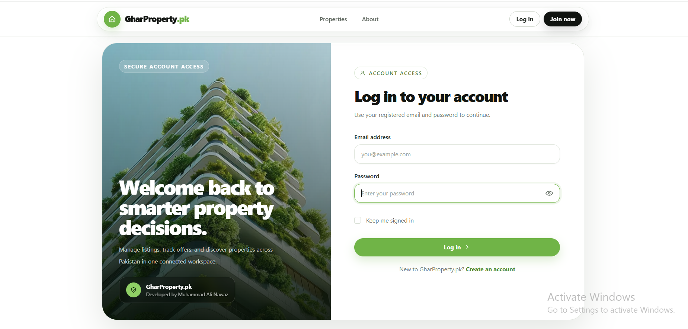
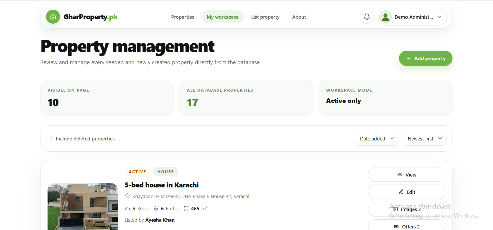
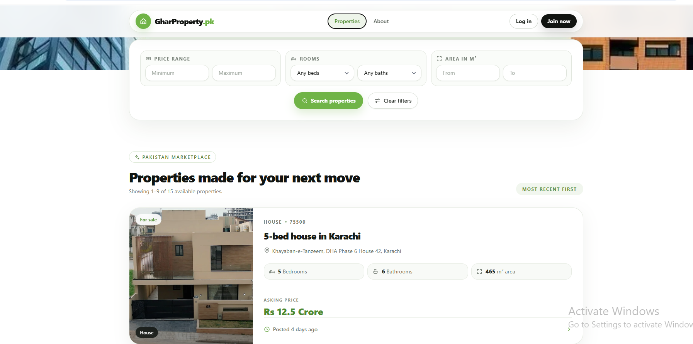

<h1 align="center">🏡 GharProperty.pk</h1>

<p align="center">
  <b>A secure, responsive Pakistan real-estate marketplace built with Laravel, Vue, Inertia.js, MySQL, and Tailwind CSS.</b>
</p>

<p align="center">
  Browse properties, publish listings, manage property images, submit offers, accept bids, receive notifications, and operate a protected administrator workspace from one full-stack application.
</p>

<p align="center">
  
  
  
  
</p>

<p align="center">
  
  
  
  
</p>

---

## 📸 Project Screenshots

| Public Marketplace | Login Page |
|---|---|
|  |  |

| Property Workspace | List a Property |
|---|---|
|  |  |

---

## 🚀 Project Overview

**GharProperty.pk** is a full-stack property marketplace designed for the Pakistan real-estate market. It combines a polished public browsing experience with authenticated property management, secure offer workflows, multiple-image support, database notifications, administrator controls, and guarded demonstration data.

The application is designed and developed by **Muhammad Ali Nawaz** as a portfolio project demonstrating practical Laravel backend development together with a modern Vue and Inertia.js frontend.

Public visitors can browse and filter available properties. Verified users can publish listings, upload property images, submit purchase offers, and manage their activity. Property owners can review and accept offers, while administrators can manage marketplace listings across the application.

---

## 🎯 Project Purpose

A property marketplace requires more than basic CRUD operations. It must safely coordinate multiple users, listing ownership, media uploads, offers, notifications, sold-property rules, administrator privileges, and public data privacy.

**GharProperty.pk** brings these workflows together in one application:

- Discover properties through responsive public listing pages
- Filter listings by price, bedrooms, bathrooms, and area
- Register and verify user accounts
- Create and manage property listings
- Upload and remove multiple property images securely
- Submit offers to property owners
- Accept one offer and reject competing offers atomically
- Notify buyers and sellers about offer activity
- Archive and restore eligible listings
- Protect sensitive actions with policies and validation
- Provide an administrator-wide property workspace
- Seed a realistic Pakistan-focused demonstration marketplace safely

The project is intended to demonstrate junior-to-intermediate Laravel skills through business rules, database integrity, testing, security controls, and maintainable application structure.

---

## 🌟 Key Highlights

- 🏡 Pakistan-focused real-estate marketplace
- 🔎 Public property search and filtering
- 💰 Localized `Lakh` and `Crore` price presentation
- 🕒 Human-readable property posting times
- 📱 Responsive mobile, tablet, and desktop interface
- 🔐 Secure custom authentication flow
- ✉️ Email verification and resend workflow
- 🚦 Login rate limiting
- 🧑‍💼 Owner-specific property workspace
- 👑 Administrator-wide property management
- 📝 Complete property CRUD workflow
- 🗂️ Soft deletion and restoration
- 🖼️ Secure cover-image and gallery uploads
- 🎞️ Full-screen property image slider
- 🧮 Monthly payment estimate component
- 🤝 Buyer offer submission
- ✅ Transactional offer acceptance
- 🚫 Duplicate and invalid offer prevention
- 🔔 Database and email notifications
- 🛡️ Laravel policies, middleware, Form Requests, and CSRF protection
- 🌱 Guarded local/testing demonstration seeding
- 🧪 63 passing automated tests with 385 assertions
- 🎨 Laravel Pint verification across 109 PHP files
- 🔍 ESLint frontend validation
- 📦 Vite production asset compilation
- ⚙️ GitHub Actions continuous integration

---

## ✨ Features

### 🌐 Public Marketplace Features

| Feature | Description |
|---|---|
| Public Property Browsing | Visitors can browse available properties without authentication |
| Responsive Property Cards | Entire property cards are clickable and adapt across screen sizes |
| Property Filters | Filter listings by minimum/maximum price, bedrooms, bathrooms, and area |
| Localized Prices | Property values are displayed using Pakistan-friendly lakh and crore formatting |
| Relative Posting Time | Listing cards and detail pages display human-readable posting times |
| Pagination | Public result sets are paginated for manageable browsing |
| Empty States | Friendly interface feedback is shown when no properties match the filters |
| Privacy-Aware Output | Public listing data exposes only the owner identifier required by the interface |

---

### 🏠 Property Detail Features

| Feature | Description |
|---|---|
| Property Overview | Displays price, address, bedrooms, bathrooms, area, and listing status |
| Single Cover Display | Only the first property image is shown in the main detail layout |
| Full-Screen Gallery | Clicking the cover opens a modal slider containing all property images |
| Keyboard Navigation | Arrow keys navigate gallery images and Escape closes the modal |
| Thumbnail Navigation | Users can select images directly from gallery thumbnails |
| Image Fallback | Missing images fall back to packaged property imagery or a placeholder |
| Monthly Payment Estimate | Calculates an estimated monthly payment from configurable values |
| Offer Interface | Eligible verified users can submit an offer directly from the property page |

---

### 🔐 Authentication and Account Security

| Feature | Description |
|---|---|
| Registration | Creates a new marketplace account with validated credentials |
| Login and Logout | Secure session-based authentication |
| Password Hashing | Passwords are stored through Laravel's secure hashing system |
| Password Confirmation Rule | Registration requires matching password confirmation |
| Email Verification | Marketplace mutations require an authenticated and verified account |
| Verification Resend | Verification messages can be requested again through a throttled endpoint |
| Session Regeneration | Login and registration regenerate the session to prevent fixation |
| Login Throttling | Repeated failed sign-in attempts are rate limited |
| Guest Redirects | Authenticated users cannot reopen guest-only authentication pages |
| CSRF Protection | Laravel CSRF middleware protects state-changing browser requests |

---

### 🧑‍💼 Property Management Features

| Feature | Description |
|---|---|
| Property Workspace | Owners see their own database-backed listings in one dashboard |
| Administrator Workspace | Administrators can view and manage listings across all owners |
| Create Property | Add property details with an optional validated cover image |
| Edit Property | Update an authorized active listing |
| View Property Details | Open a management-aware property preview from the workspace |
| Archive Property | Soft-delete eligible unsold listings without permanent data loss |
| Restore Property | Restore a deleted listing when authorized |
| Status Display | Distinguishes active, sold, and archived listings |
| Owner Display | Administrator views identify each listing owner |
| Offer Counts | Workspace cards display associated offer totals |
| Image Counts | Workspace cards display associated image totals |
| Responsive Actions | Edit, images, offers, archive, and restore controls adapt to screen size |

---

### 🖼️ Property Image Features

| Feature | Description |
|---|---|
| Cover Image Upload | A cover image can be uploaded while creating a property |
| Multiple Image Upload | Owners can add multiple images through the image-management page |
| Upload Preview | The create form displays a client-side preview before submission |
| Secure Validation | Images are checked for type, MIME, size, dimensions, and request limits |
| Supported Formats | JPEG, PNG, and WebP property images are accepted |
| Listing Image Cap | Application rules prevent excessive images from being stored |
| Database Association | Every uploaded image is related to its owning listing |
| Storage Cleanup | Files are removed when database persistence fails |
| Scoped Deletion | Images cannot be deleted through an unrelated parent listing |
| Fallback Gallery | Listings without uploaded media use stable packaged fallback images |

---

### 🤝 Offer and Sale Features

| Feature | Description |
|---|---|
| Submit Offer | A verified buyer can submit an amount for an eligible property |
| Owner Restriction | A property owner cannot submit an offer on their own listing |
| Sold Restriction | New offers cannot be created for a sold property |
| Administrator Business Rule | Administrator offer actions are restricted where required |
| Duplicate Prevention | A bidder cannot create duplicate offers for the same property |
| Database Constraint | Listing and bidder uniqueness is also enforced at database level |
| Owner Offer Page | Listing owners can view offers associated with their property |
| Accept Offer | An authorized owner can accept an eligible offer |
| Atomic Sale | Offer acceptance and listing sale status are updated transactionally |
| Competing Rejection | Other offers are rejected when one offer is accepted |
| Idempotent Replay | Repeating the same accepted action does not duplicate side effects |
| Sold Integrity | Owners cannot delete sold listings and accepted bidders retain access |

---

### 🔔 Notification Features

| Feature | Description |
|---|---|
| Offer Submitted | Property owners receive notification of a new offer |
| Offer Accepted | The successful bidder receives an acceptance notification |
| Offer Rejected | Competing bidders receive rejection notifications |
| Database Notifications | Notifications are stored for display within the application |
| Email Channel | Offer notifications can also be delivered through configured mail |
| Read Status | Users can mark their own notifications as seen |
| Authorization | Notification actions are protected by policy checks |
| Transaction Safety | Acceptance notifications are dispatched only after the sale commits |

---

## 👥 Marketplace Access Model

The application uses authenticated ownership and an administrator flag rather than a large role-permission package.

| Persona | Access Level |
|---|---|
| 👑 Administrator | Views and manages marketplace properties across all users; can review deleted property details and restore authorized listings |
| 🏠 Property Owner | Creates and manages owned properties, uploads images, reviews offers, and accepts eligible bids |
| 🤝 Buyer | Browses properties, submits eligible offers, and receives offer-status notifications |
| 🌐 Visitor | Browses and filters public properties without authentication |

The seeded seller, agent, buyer, and investor accounts are demonstration personas. Authorization is determined by authentication state, email verification, property ownership, listing state, and administrator status.

---

## 🛠 Technology Stack

| Layer | Technologies |
|---|---|
| Backend | Laravel 12, PHP 8.2+ |
| Frontend | Vue 3, Inertia.js 3 |
| UI and Styling | Tailwind CSS 3, PostCSS, Autoprefixer |
| Database | MySQL or MariaDB |
| Authentication | Custom Laravel session authentication and email verification |
| Authorization | Laravel policies and middleware |
| ORM | Eloquent models, relationships, scopes, and factories |
| Media Storage | Laravel public filesystem disk |
| Notifications | Laravel database and mail notification channels |
| API Utilities | Laravel Sanctum is available as a project dependency |
| Routing Helpers | Tighten Ziggy / `ziggy-js` |
| Asset Build | Vite 8 with Laravel Vite Plugin |
| Testing | PHPUnit 11 and Laravel feature tests |
| Code Style | Laravel Pint |
| Frontend Quality | ESLint with Vue plugin |
| CI | GitHub Actions |
| Package Management | Composer and NPM |
| Optional Local Services | Docker Compose, MariaDB, and Adminer |

---

## 🏗 Architecture Overview

The application follows Laravel MVC conventions while using Inertia.js to connect Laravel controllers with Vue pages.

```text
Request
   ↓
Laravel Route
   ↓
Authentication / Verification Middleware
   ↓
Form Request Validation
   ↓
Controller
   ↓
Policy Authorization
   ↓
Eloquent Models / Database Transaction
   ↓
Inertia Response
   ↓
Vue Page and Reusable Components
```

### Main Application Structure

```text
gharproperty-pk/
├── app/
│   ├── Http/
│   │   ├── Controllers/
│   │   │   ├── ListingController.php
│   │   │   ├── ListingOfferController.php
│   │   │   ├── RealtorListingController.php
│   │   │   ├── RealtorListingImageController.php
│   │   │   ├── RealtorListingAcceptOfferController.php
│   │   │   ├── LoginController.php
│   │   │   ├── RegisterController.php
│   │   │   └── NotificationController.php
│   │   ├── Middleware/
│   │   └── Requests/
│   ├── Models/
│   │   ├── User.php
│   │   ├── Listing.php
│   │   ├── ListingImage.php
│   │   └── Offer.php
│   ├── Notifications/
│   ├── Policies/
│   └── Providers/
├── database/
│   ├── factories/
│   ├── migrations/
│   └── seeders/
├── docs/
│   └── screenshots/
├── public/
│   └── images/gharproperty/
├── resources/
│   ├── css/
│   ├── js/
│   │   ├── Components/
│   │   ├── Composables/
│   │   ├── Layouts/
│   │   ├── Pages/
│   │   └── Support/
│   └── views/
├── routes/
├── storage/
├── tests/
│   ├── Feature/
│   └── Unit/
├── .github/workflows/ci.yml
├── .env.example
├── composer.json
├── package.json
└── README.md
```

---

## 🔄 Application Flows

### Public Property Discovery

```text
Open Marketplace
        ↓
Load Paginated Active Listings
        ↓
Apply Price / Beds / Baths / Area Filters
        ↓
Review Responsive Property Cards
        ↓
Open Property Detail Page
        ↓
Click Cover Image to View Full Gallery
```

### Property Publishing Flow

```text
Register or Login
        ↓
Verify Email Address
        ↓
Open Property Workspace
        ↓
Create Property and Optional Cover Image
        ↓
Validate Property and Image Data
        ↓
Store Listing in a Database Transaction
        ↓
Associate Stored Image
        ↓
Manage Additional Property Images
```

### Offer Workflow

```text
Verified Buyer Opens Property
        ↓
Submit Offer Amount
        ↓
Validate Eligibility and Duplicate Rules
        ↓
Store Offer
        ↓
Notify Property Owner
        ↓
Owner Opens Offer Management Page
        ↓
Accept One Eligible Offer
        ↓
Lock Listing and Offers in Transaction
        ↓
Mark Property Sold
        ↓
Reject Competing Offers
        ↓
Dispatch Notifications After Commit
```

### Property Archive and Restore Flow

```text
Owner or Administrator Opens Workspace
        ↓
Request Property Archive
        ↓
Authorize Listing Deletion
        ↓
Reject Deletion When Sold
        ↓
Soft Delete Eligible Property
        ↓
Include Archived Properties in Workspace Filter
        ↓
Authorize Restore
        ↓
Restore Property Record
```

---

## 🗄 Database Overview

The application uses Laravel migrations with MySQL or MariaDB in local and production environments. SQLite is used by the continuous-integration test workflow.

### Main Tables

| Table | Purpose |
|---|---|
| `users` | Stores user identity, authentication data, email verification, and administrator status |
| `listings` | Stores property specifications, address, price, owner, sale status, and soft-deletion state |
| `listing_images` | Stores image paths associated with individual properties |
| `offers` | Stores bidder amounts, acceptance timestamps, rejection timestamps, and listing relationships |
| `notifications` | Stores Laravel database notifications for marketplace users |
| `password_reset_tokens` | Supports Laravel password-reset infrastructure |
| `personal_access_tokens` | Supports Sanctum personal-access tokens when API authentication is added |
| `failed_jobs` | Supports failed queue-job records when asynchronous queues are enabled |

### Data Integrity

- Foreign keys protect related records
- User email addresses are unique
- Offers enforce one bidder/listing combination at database level
- Listings support soft deletion
- Sold properties store a sale timestamp
- Offers store accepted and rejected decision timestamps
- Migrations are tested for rollback and re-execution
- Factories provide safe test records
- Demo seeders are deterministic and idempotent

---

## 🔐 Security Implementations

| Security Area | Implementation |
|---|---|
| Authentication | Laravel session authentication through dedicated controllers |
| Password Storage | Secure Laravel hashing through the model password cast |
| Session Security | Session regeneration after successful login and registration |
| Email Verification | Authenticated marketplace mutations require verified email addresses |
| Login Rate Limiting | Repeated failed sign-in attempts are throttled |
| CSRF Protection | Laravel CSRF middleware protects browser state changes |
| Authorization | Policies protect listings, notifications, offers, images, deletion, and restoration |
| Ownership Checks | Users cannot manage another owner's property or images |
| Administrator Access | Administrator privileges are checked server-side |
| Form Requests | Listing, filtering, and image requests use dedicated validation classes |
| Mass Assignment | Eloquent models define controlled fillable or guarded behavior |
| Duplicate Offers | Application validation and a database unique constraint prevent duplicates |
| Offer Atomicity | Sale and offer decisions use transactions and row-level locks |
| Post-Commit Side Effects | Notifications are dispatched after successful transaction commit |
| Image Validation | Upload MIME, extension, size, dimensions, and quantity are restricted |
| File Cleanup | Stored files are removed when persistence fails |
| Scoped Media Routes | Images cannot be managed through an unrelated listing route |
| Soft-Delete Safety | Restore and deleted-detail actions remain authorization protected |
| Production Seeder Guard | Demo seeding is rejected outside local and testing environments |
| Strong Demo Password | Demo seeding requires an explicitly supplied strong password |
| Environment Protection | Real credentials belong in `.env`, which is excluded from Git |
| Public Data Privacy | Public listing serialization limits exposed owner information |
| Unknown Routes | A dedicated fallback returns an application 404 page |

---

## ⚡ Performance and Code Quality

- Uses eager loading where listing relationships are rendered
- Uses pagination for public and management listing collections
- Uses database-level uniqueness for critical offer integrity
- Uses transactions and row-level locks for concurrent offer acceptance
- Uses Vue components for repeated interface patterns
- Uses a shared property-presentation utility for consistent image and title behavior
- Uses a reusable price component for localized values
- Uses Inertia.js to avoid a separate REST API for the browser interface
- Uses Vite for optimized production frontend assets
- Uses image fallback behavior to prevent broken property cards
- Uses Form Requests to keep validation outside controller actions
- Uses policies to centralize authorization decisions
- Uses feature tests for authentication, authorization, validation, storage, offers, seeders, migrations, privacy, and sold-property rules
- Uses Laravel Pint for PHP formatting verification
- Uses ESLint for Vue and JavaScript validation
- Uses Composer and NPM dependency audits in CI
- Uses GitHub Actions to verify migrations, tests, caches, linting, and production builds

---

## 📡 Main Routes and System Areas

| Area | Purpose |
|---|---|
| `/` | Public marketplace landing page |
| `/listing` | Public paginated property results |
| `/listing/{listing}` | Public property detail page |
| `/login` | User login |
| `/register` | User registration |
| `/email/verify` | Email-verification notice |
| `/email/verification-notification` | Resend verification message |
| `/notification` | Authenticated notification centre |
| `/realtor/listing` | Owner or administrator property workspace |
| `/realtor/listing/create` | Create a property |
| `/realtor/listing/{listing}` | Property management offer page |
| `/realtor/listing/{listing}/details` | Property preview from the management workspace |
| `/realtor/listing/{listing}/edit` | Edit an authorized property |
| `/realtor/listing/{listing}/image/create` | Manage property images |
| `/realtor/listing/{listing}/restore` | Restore an authorized archived property |
| `/realtor/offer/{offer}/accept` | Accept an eligible property offer |

---

## ⚙️ Installation Guide

### Requirements

- PHP 8.2 or higher
- Composer 2
- Node.js 22+ and NPM
- MySQL or MariaDB
- Required PHP extensions for Laravel and your selected database driver
- Git
- XAMPP, WAMP, Laragon, Docker, or a comparable local environment

---

### 1️⃣ Clone the Repository

```bash
git clone https://github.com/YOUR_GITHUB_USERNAME/gharproperty-pk.git
cd gharproperty-pk
```

---

### 2️⃣ Install PHP Dependencies

```bash
composer install
```

---

### 3️⃣ Install Frontend Dependencies

```bash
npm ci
```

Use `npm install` only when intentionally changing frontend dependency versions.

---

### 4️⃣ Create the Environment File

Windows PowerShell:

```powershell
Copy-Item .env.example .env
```

Windows Command Prompt:

```bat
copy .env.example .env
```

macOS/Linux:

```bash
cp .env.example .env
```

---

### 5️⃣ Generate the Application Key

```bash
php artisan key:generate
```

---

### 6️⃣ Create the Database

Example MySQL or MariaDB database:

```sql
CREATE DATABASE gharproperty_pk
    CHARACTER SET utf8mb4
    COLLATE utf8mb4_unicode_ci;
```

For a dedicated local database user:

```sql
CREATE USER 'gharproperty'@'127.0.0.1'
    IDENTIFIED BY 'replace-with-a-strong-local-password';

GRANT ALL PRIVILEGES ON gharproperty_pk.*
    TO 'gharproperty'@'127.0.0.1';

FLUSH PRIVILEGES;
```

Update `.env`:

```env
APP_NAME="GharProperty.pk"
APP_ENV=local
APP_DEBUG=true
APP_URL=http://127.0.0.1:8000

DB_CONNECTION=mysql
DB_HOST=127.0.0.1
DB_PORT=3306
DB_DATABASE=gharproperty_pk
DB_USERNAME=gharproperty
DB_PASSWORD=replace-with-a-strong-local-password

MAIL_MAILER=log
ALLOW_DEMO_SEEDING=false
DEMO_PASSWORD=
```

Never commit the real `.env` file.

---

### 7️⃣ Run Database Migrations

```bash
php artisan migrate
```

---

### 8️⃣ Create the Public Storage Link

```bash
php artisan storage:link
```

This exposes files stored under `storage/app/public` through `public/storage`.

---

### 9️⃣ Build Frontend Assets

Production build:

```bash
npm run build
```

Development server with frontend hot reload:

```bash
npm run dev
```

---

### 🔟 Start the Laravel Application

```bash
php artisan serve --host=127.0.0.1 --port=8000
```

Open:

```text
http://127.0.0.1:8000
```

When using `npm run dev`, continue opening the Laravel URL above rather than opening the Vite development port directly.

---

## 🐳 Optional Docker Database

The repository includes Docker Compose services for MariaDB and Adminer.

Start the services:

```bash
docker compose up -d
```

Local service addresses:

```text
MariaDB: 127.0.0.1:3306
Adminer: http://127.0.0.1:8080
```

Stop the services:

```bash
docker compose down
```

Remove the Docker database volume only when you intentionally want to delete its stored data:

```bash
docker compose down -v
```

---

## 🌱 Optional Local Demo Marketplace

Demo seeding is intentionally protected. It only runs when:

- `APP_ENV` is `local` or `testing`
- `ALLOW_DEMO_SEEDING=true`
- `DEMO_PASSWORD` contains a strong password

> Warning: `migrate:fresh` removes every existing database table and record. Use it only with a disposable local database.

### Windows PowerShell

```powershell
$ErrorActionPreference = "Stop"

$env:APP_ENV = "local"
$env:ALLOW_DEMO_SEEDING = "true"
$env:DEMO_PASSWORD = "PortfolioDemo!2026"

try {
    php artisan migrate:fresh --seed --force
    php artisan storage:link
}
finally {
    Remove-Item Env:APP_ENV -ErrorAction SilentlyContinue
    Remove-Item Env:ALLOW_DEMO_SEEDING -ErrorAction SilentlyContinue
    Remove-Item Env:DEMO_PASSWORD -ErrorAction SilentlyContinue
}
```

### macOS/Linux

```bash
APP_ENV=local \
ALLOW_DEMO_SEEDING=true \
DEMO_PASSWORD='PortfolioDemo!2026' \
php artisan migrate:fresh --seed --force

php artisan storage:link
```

The seeder creates deterministic users, properties, images, offers, notifications, active listings, sold listings, and an archived listing for local demonstration.

---

## 🔑 Demo Login Credentials

All demonstration accounts use the password:

```text
PortfolioDemo!2026
```

| Persona | Email | Example Access |
|---|---|---|
| 👑 Administrator | `admin@example.com` | Manage marketplace properties across users |
| 🏠 Property Seller | `seller@gharproperty.test` | Manage owned listings and offers |
| 🧑‍💼 Property Agent | `agent@gharproperty.test` | Manage owned listings and offers |
| 🤝 Buyer | `buyer@gharproperty.test` | Browse and submit eligible offers |
| 📈 Investor | `investor@gharproperty.test` | Browse and submit eligible offers |

These credentials are intended only for guarded local demonstration data.

---

## 📨 Mail Configuration

For simple local development without an SMTP server:

```env
MAIL_MAILER=log
MAIL_FROM_ADDRESS="hello@gharproperty.pk"
MAIL_FROM_NAME="${APP_NAME}"
```

Messages are written to:

```text
storage/logs/laravel.log
```

For Mailpit or another local SMTP service:

```env
MAIL_MAILER=smtp
MAIL_HOST=127.0.0.1
MAIL_PORT=1025
MAIL_USERNAME=null
MAIL_PASSWORD=null
MAIL_ENCRYPTION=null
```

For production, configure a trusted transactional mail provider and store credentials only in environment variables or a secrets manager.

---

## 🏗 Production Build and Deployment Checklist

Recommended production environment values:

```env
APP_ENV=production
APP_DEBUG=false
APP_URL=https://your-domain.example
ALLOW_DEMO_SEEDING=false
DEMO_PASSWORD=
SESSION_SECURE_COOKIE=true
```

Install optimized PHP dependencies:

```bash
composer install --no-dev --optimize-autoloader --no-interaction
```

Compile frontend assets:

```bash
npm ci
npm run build
```

Run database migrations:

```bash
php artisan migrate --force
```

Create the storage link:

```bash
php artisan storage:link
```

Cache Laravel configuration and routes:

```bash
php artisan optimize
```

Additional production requirements:

- Configure a web server such as Nginx or Apache with `public/` as the document root
- Use HTTPS
- Set secure database credentials
- Configure a production mail provider
- Configure filesystem permissions for `storage/` and `bootstrap/cache/`
- Use a persistent queue worker when changing `QUEUE_CONNECTION` from `sync`
- Configure backups, monitoring, error reporting, and log rotation
- Keep `APP_DEBUG=false`
- Never enable demo seeding in production
- Never commit `.env`, uploaded files, logs, cache files, `vendor`, or `node_modules`

---

## 🧪 Testing and Verification

Run the Laravel test suite:

```bash
php artisan test
```

Check PHP formatting:

```bash
./vendor/bin/pint --test
```

Windows PowerShell:

```powershell
.\vendor\bin\pint.bat --test
```

Validate Vue and JavaScript:

```bash
npm run lint
```

Compile the production frontend:

```bash
npm run build
```

Validate Composer metadata:

```bash
composer validate --strict
```

Audit PHP dependencies:

```bash
composer audit --locked
```

Audit frontend dependencies:

```bash
npm audit --audit-level=moderate
```

### Last Verified Results

| Verification | Result |
|---|---|
| Laravel Tests | ✅ 63 passed |
| Assertions | ✅ 385 assertions |
| Laravel Pint | ✅ 109 PHP files passed |
| Frontend Lint | ✅ Completed successfully |
| Vite Build | ✅ 588 modules transformed and production build completed |
| Demo Seeder Tests | ✅ 2 tests passed with 103 assertions |
| Migration Rollback Test | ✅ Passed |
| Authentication and Security Tests | ✅ Passed |
| Authorization Tests | ✅ Passed |
| Image Upload and Limit Tests | ✅ Passed |
| Offer and Sold-Property Integrity Tests | ✅ Passed |

---

## 🔁 Continuous Integration

The GitHub Actions workflow runs on every push and pull request.

It verifies:

- Composer metadata
- PHP dependency installation
- PHP platform requirements
- Composer security audit
- SQLite test database preparation
- Migration execution, rollback, and re-execution
- Complete Laravel test suite
- Laravel Pint formatting
- Laravel config, event, route, and view caching
- NPM dependency installation
- NPM security audit
- ESLint validation
- Vite production build

Workflow file:

```text
.github/workflows/ci.yml
```

---

## 📁 Important Folder Structure

```text
app/Http/Controllers/
├── EmailVerificationController.php
├── EmailVerificationNoticeController.php
├── EmailVerificationNotificationController.php
├── ListingController.php
├── ListingOfferController.php
├── LoginController.php
├── NotificationController.php
├── NotificationMarkAsReadController.php
├── RealtorListingAcceptOfferController.php
├── RealtorListingController.php
├── RealtorListingImageController.php
└── RegisterController.php

app/Http/Requests/
├── BrowseListingsRequest.php
├── StoreListingImagesRequest.php
├── StoreListingRequest.php
└── UpdateListingRequest.php

app/Models/
├── Listing.php
├── ListingImage.php
├── Offer.php
└── User.php

app/Policies/
├── ListingPolicy.php
└── NotificationPolicy.php

resources/js/Pages/
├── Auth/
├── Listing/
├── Notification/
└── Realtor/

tests/Feature/
├── AdministratorOfferBusinessRuleTest.php
├── AuthenticationSecurityTest.php
├── DemoMarketplaceSeederTest.php
├── DemoSeederAuthenticationTest.php
├── FrontendUiAssetTest.php
├── ListingFilterValidationTest.php
├── ListingImageLimitTest.php
├── ListingValidationTest.php
├── MigrationRollbackTest.php
├── NotificationDestinationTest.php
├── OfferAcceptanceTest.php
├── PublicListingPrivacyTest.php
├── RealtorListingAuthorizationTest.php
├── RealtorListingImageAuthorizationTest.php
├── SecurityRemediationTest.php
└── SoldListingIntegrityTest.php
```

---

## ✅ Portfolio Verification Checklist

- [x] Laravel MVC structure
- [x] Vue and Inertia.js frontend
- [x] MySQL/MariaDB migrations
- [x] Eloquent models and relationships
- [x] Factories and guarded seeders
- [x] Public property browsing
- [x] Property filtering and pagination
- [x] Registration and secure login
- [x] Email verification
- [x] Session regeneration
- [x] Login throttling
- [x] Property CRUD
- [x] Administrator property workspace
- [x] Soft deletion and restoration
- [x] Secure cover-image upload
- [x] Multiple property images
- [x] Full-screen image gallery
- [x] Scoped image deletion
- [x] Duplicate-offer prevention
- [x] Atomic offer acceptance
- [x] Competing-offer rejection
- [x] Sold-listing integrity rules
- [x] Database notifications
- [x] Authorization policies
- [x] Form Request validation
- [x] Public privacy controls
- [x] Guarded production-safe demo seeding
- [x] Deterministic local demo marketplace
- [x] 63 automated tests
- [x] 385 assertions
- [x] Laravel Pint verification
- [x] ESLint validation
- [x] Vite production build
- [x] Composer and NPM audits
- [x] GitHub Actions CI
- [x] Screenshot documentation included
- [x] Repository cleanup and ignore rules

---

## 👨‍💻 Author

**Muhammad Ali Nawaz**  
PHP / Laravel Developer

---

## 📄 License

This project is open-source software licensed under the [MIT License](LICENSE).


---

<p align="center">
  <b>⭐ If you find GharProperty.pk useful, consider starring the repository!</b>
</p>
